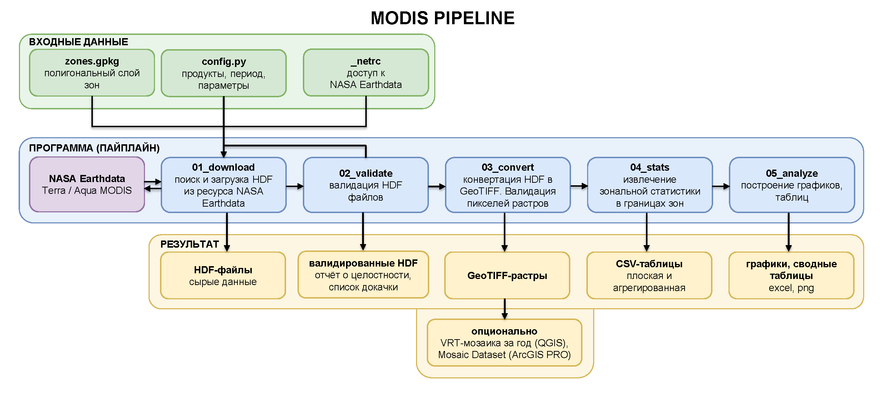

# MODIS Pipeline

Проект представляет собой автоматизированный пайплайн загрузки и обработки спутниковых данных MODIS. Система реализует полный цикл работы с растровыми данными: автоматическую загрузку HDF-гранул через NASA Earthdata API, валидацию целостности файлов средствами GDAL, конвертацию в ГИС-форматы с QA-фильтрацией, расчёт зональной статистики по полигонам и расширенный анализ с визуализацией. Архитектура построена на модульном принципе с централизованной конфигурацией: каждый этап запускается пользователем и выполняется отдельным модулем с поддержкой CLI-флагов.

## Оглавление

- [Ключевые возможности](#ключевые-возможности)
- [Схема пайплайна](#схема-пайплайна)
- [Структура проекта](#структура-проекта)
- [Установка и развертывание](#установка-и-развертывание)
- [Конфигурация](#конфигурация)
- [Запуск приложения](#запуск-приложения)
- [Справочник команд CLI](#справочник-команд-cli)
- [Результаты и выходные файлы](#результаты-и-выходные-файлы)
  - [Растровые данные (GeoTIFF)](#растровые-данные-geotiff)
  - [Таблицы зональной статистики](#таблицы-зональной-статистики)
  - [Таблицы анализа](#таблицы-анализа)
  - [Excel-книга modis_analysis.xlsx](#excel-книга-modis_analysisxlsx)
  - [Графики](#графики)
  - [Логи и провенанс](#логи-и-провенанс)
  - [Работа в ГИС](#работа-в-гис)
- [Типовые сценарии](#типовые-сценарии)
- [Тестирование](#тестирование)
- [Примечания и ограничения](#примечания-и-ограничения)

## Ключевые возможности

- **Автоматическая загрузка данных MODIS из NASA.** Программа подключается к серверам NASA через библиотеку `earthaccess`, находит снимки, которые покрывают вашу область исследования, и скачивает их за выбранные годы. Скачивание идёт порциями (батчами) с паузами и повторными попытками, поэтому обрывы связи и временные сбои сервера не приводят к потере прогресса. Доступны 10 продуктов: температура поверхности днём и ночью (LST, LST_Night), вегетационные индексы (NDVI, EVI, EVI2), снежный покров (Snow, Snow_Daily), земной покров (Land_Cover), пожары (Fire) и альбедо (Albedo).

- **Автоматический контроль качества снимков (QA-фильтрация).** В каждом снимке MODIS есть служебные «флаги качества» — отметки о том, какие пиксели были закрыты облаками или получены с низкой надёжностью. Программа читает эти флаги (QC_Day, QC_Night, VI_Quality, Quality) и исключает неподходящие пиксели из расчётов, чтобы в статистику попадали только достоверные значения.

- **Возобновление после сбоев (resume).** Все этапы запоминают, что уже сделано. При прерывании работы (Ctrl+C), потере связи или отключении питания при повторном запуске программа продолжит с места остановки: уже скачанные файлы, сконвертированные растры и посчитанная статистика повторно не обрабатываются.

- **Доступность для ГИС.** Программа переводит «сырой» формат NASA (HDF) в общепринятый GeoTIFF. Дополнительно можно собрать все тайлы года в один слой (VRT-мозаика), записать данные в формате Cloud Optimized GeoTIFF для быстрой отрисовки больших сцен, перепроецировать растры в WGS84, а для пользователей ArcGIS Pro — автоматически собрать Mosaic Dataset в файловой геобазе (GDB).

- **Быстрая обработка (многопоточность).** Проверка файлов, конвертация снимков и расчёт статистики выполняются параллельно в несколько потоков процессора.

- **Воспроизводимость результатов.** Каждый запуск сохраняет provenance-JSON в `output/logs/run_<этап>_*.json` с параметрами (годы, продукты, зоны, флаги) и версиями всех библиотек — важное требование для научных работ.

- **Расширенная аналитика.** Помимо базовой статистики (mean, std, median, min, max, перцентили, коэффициент вариации), анализатор считает годовые аномалии относительно базового периода, фенологические метрики (начало, пик и конец сезона, длина сезона), матрицу корреляций зон по аномалиям, PCA сезонного цикла, а также строит широкие таблицы «период × зоны» для быстрого импорта в Origin Pro.

- **Самодокументируемые результаты.** Вместе с таблицами всегда создаётся словарь таблиц (`tables_help.csv` и лист `HELP` в Excel-книге): назначение каждой таблицы, состав колонок и рекомендуемые оси X/Y для Origin. Открыв словарь, легко понять, где что лежит и как построить нужный график.

- **Удобный экспорт результатов.** Зональная статистика сохраняется в CSV-таблицах в русской локали (разделитель `;`, десятичный знак `,`); Excel-книга `modis_analysis.xlsx` со всеми листами и словарём `HELP` создаётся автоматически при каждом запуске `05_analyze`; PNG-графики 12 типов покрывают сезонность, тренды, градиенты, амплитуду, корреляции, аномалии, фенологию и распределения.

- **Согласованный календарь месяцев.** Месяц записи определяется по номинальному (невисокосному) календарю MODIS, поэтому месяцы, запрошенные при скачивании, всегда совпадают с месяцами в таблицах и на графиках, независимо от високосных лет.

## Схема пайплайна



| Этап | Что делает | Вход | Выход |
|------|------------|------|-------|
| `01_download` | Ищет и скачивает снимки NASA за выбранный период | `zones.gpkg`, `_netrc`, параметры из `config.py` | HDF-файлы: `data/raw/<PRODUCT>/<год>/*.hdf` |
| `02_validate` | Проверяет целостность файлов, удаляет битые | HDF-файлы из `data/raw/` | Отчёт `validation_report_*.json` и список `redownload_list_*.json` |
| `03_convert` | Переводит в физические величины, фильтрует по качеству, пишет в ГИС-формат | HDF-файлы из `data/raw/` | GeoTIFF + VRT-мозаика; опционально COG, WGS84, Mosaic Dataset |
| `04_stats` | Считает статистику по каждой зоне: mean, std, median, min, max, перцентили, CV; для категориальных продуктов — индекс Шеннона и доминирующий класс | GeoTIFF + `zones.gpkg` | `zonal_stats_flat.csv` и `zonal_stats_flat_agg.csv` |
| `05_analyze` | Строит графики и сводки: сезонность, тренды, широтный градиент, амплитуда, корреляция, аномалии, фенология, PCA; собирает Excel-книгу и словарь таблиц | `zonal_stats_flat.csv` | PNG-графики, CSV-сводки, `origin_pivot_*.csv`, `tables_help.csv`, `modis_analysis.xlsx` |

Этапы 02–05 принимают результат предыдущего этапа, поэтому вручную задаются только вход первого этапа: зоны и настройки конфига `config.py`.

## Структура проекта

```text
modis_download_analysis/
├── modis_pipeline.py              # Единая точка входа: python modis_pipeline.py <команда> [флаги]
├── config.py                      # Конфигурация: пути, продукты, период, параметры загрузки
├── environment.yml                # Зависимости Python
├── README.md
├── cli/
│   └── main.py                    # Парсеры подкоманд и диспетчеризация этапов
├── core/                          # Этапы пайплайна (выполняются в порядке 01 → 05)
│   ├── 01_downloader.py           # Скачивание HDF-гранул через earthaccess
│   ├── 02_validator.py            # Валидация HDF: целостность, удаление битых файлов
│   ├── 03_converter.py            # HDF → GeoTIFF: масштабирование, QA-фильтрация, VRT/COG/Mosaic
│   ├── 04_zonal_stats.py          # Зональная статистика по полигонам (GDAL + NumPy)
│   └── 05_analyzer.py             # Анализ: графики, сводные таблицы, Excel-книга, словарь таблиц
├── utils/
│   ├── messages.py                # Все текстовые сообщения логов и CLI
│   ├── config_loader.py           # Парсинг и интерактивный ввод параметров
│   ├── geo_utils.py               # Работа с GeoPackage: зоны, bbox, проверка покрытия
│   ├── logger.py                  # Логирование в консоль и файл
│   └── provenance.py              # Сохранение параметров запуска (воспроизводимость)
├── tests/
│   └── smoke_test.py              # Офлайн-проверки кода, конфигурации и артефактов
├── data/                          # Создаётся автоматически
│   ├── raw/                       # Исходные HDF-файлы
│   │   └── <PRODUCT>/<год>/*.hdf
│   ├── processed/                 # Конвертированные GeoTIFF
│   │   └── <продукт>/<год>/*.tif + <продукт>_<год>.vrt
│   └── tables/                    # Статистика и отчёты валидации
│       ├── zonal_stats_flat.csv
│       ├── zonal_stats_flat_agg.csv
│       ├── validation_report_*.json
│       └── redownload_list_*.json
├── gis/
│   └── zones.gpkg                 # Входные полигоны зон (WGS84)
└── output/
    ├── figures/                   # PNG-графики, CSV-сводки, origin_pivot_*.csv,
    │                              # tables_help.csv, modis_analysis.xlsx
    ├── logs/                      # pipeline_*.log и provenance run_<этап>_*.json
    └── gis/                       # modis_mosaics.gdb (флаг --mosaic, ArcGIS Pro)
```

## Установка и развертывание

Все команды выполняются в терминале, где доступна conda.

**1. Перейдите в папку проекта:**

```bash
cd <путь к проекту>
```

**2. Создайте окружение из `environment.yml`:**

```bash
conda env create --prefix .\venv -f environment.yml
```

**3. Защитите окружение от посторонних пакетов (опционально, только Windows):**

```bash
conda env config vars set PYTHONNOUSERSITE=1 --prefix .\venv
```

**4. Активируйте окружение:**

```bash
conda activate .\venv
```

**5. Проверьте, что GDAL читает HDF:**

```bash
gdalinfo --formats | findstr HDF
```

В выводе должны быть строки `HDF4` и `HDF4Image`. Если их нет, установите пакеты `libgdal-hdf4` и `libgdal-hdf5` из канала conda-forge в ваше окружение.

**6. Авторизация на портале `urs.earthdata.nasa.gov`.**
По адресу `C:\Users\<имя пользователя ПК>` создайте файл с названием строго `_netrc` (на Windows) или `.netrc` (на Linux) **без расширения файла**. В содержании файла укажите:

```text
machine urs.earthdata.nasa.gov
login <ваш логин учетной записи для авторизации>
password <ваш пароль учетной записи>
```

**7. Подготовьте файл зон.**
Положите GeoPackage с полигонами ваших зон в `gis/zones.gpkg`. Требования: полигональный слой в системе координат WGS84 (EPSG:4326). Поля `id` и `name` необязательны — если их нет, пайплайн пронумерует зоны сам и даст им имена `zone_1`, `zone_2` и так далее.

**8. Самодиагностика:**

```bash
python modis_pipeline.py selftest
```

Команда проверяет зависимости, GDAL с HDF4, конфигурацию, авторизацию в NASA, файл зон. Если все строки `[OK]` — установка завершена.

### Активация созданного окружения

Активация окружения выполняется в зависимости от того, каким дистрибутивом Python оно создано и где расположена папка окружения.

**Вариант 1. Через окружение ArcGIS Pro** (если `.\venv` клонировалось из pro-окружения):

```bash
"C:\Program Files\ArcGIS\Pro\bin\Python\Scripts\proenv.bat"
cd <полный путь к папке проекта>
conda activate .\venv
```

**Вариант 2. Через Anaconda / Miniconda**:

```bash
cd <полный путь к папке проекта>
conda activate .\venv
```

## Конфигурация

Все пользовательские настройки собраны в одном файле — `config.py` в корне проекта. Каждый этап читает параметры из конфига.

### Переменные для корректировки

| Настройка | Назначение | Когда менять |
|-----------|------------|--------------|
| `ZONES_GPKG` | путь к файлу зон `gis/zones.gpkg` | если файл лежит в другом месте (или передавайте `--zones`) |
| `TEMPORAL_RANGE` | период по умолчанию: годы и месяцы | если не задаёте период флагами CLI |
| `MODIS_PRODUCTS` | список продуктов и правила их обработки | чтобы включить или добавить продукт |
| `CSV_SEPARATOR`, `CSV_DECIMAL` | локаль CSV-таблиц (`;` и `,` — русская локаль Excel) | если нужна англоязычная локаль (`","` и `"."`) |
| `CONVERT_MAX_WORKERS` | число потоков конвертации | под возможности компьютера |
| `ANOMALY_BASELINE_YEARS` | базовый период (климатическая норма) для расчёта аномалий | если нужна другая норма |
| `PHENOLOGY_THRESHOLD_FRACTION` | доля амплитуды, определяющая пороги начала и конца сезона | если нужна другая методика фенологии |
| `PERCENTILES` | набор перцентилей, записываемых в flat-таблицу | при необходимости других квантилей |
| `MONTH_CUMDAYS` | границы месяцев в днях года (номинальный календарь MODIS) | не менять |

Остальные параметры (пути `DATA_PATHS`, паузы загрузки, форматы дат, настройки GDAL) имеют разумные значения по умолчанию — меняйте их, только при необходимости.

### Продукты MODIS

Каждый продукт — запись в словаре `MODIS_PRODUCTS`. Ключ словаря — имя, которым вы пользуетесь в командах (`--products LST,NDVI`).

| Поле | Что означает |
|------|-------------|
| `product` | код коллекции NASA (short name), по нему идёт поиск гранул |
| `version` | версия коллекции (для MODIS сейчас `061`) |
| `band` | имя бэнда (поддатасета), который извлекается из HDF |
| `resolution`, `temporal_resolution` | справочные поля: разрешение и периодичность |
| `scale_factor`, `offset` | перевод «сырых» значений в физические: `значение = DN * scale_factor + offset` |
| `no_data_value` | fill-значение сырых данных; такие пиксели исключаются до масштабирования |
| `unit` | единица измерения; попадает в метаданные GeoTIFF и в подписи осей графиков |
| `data_type` | тип продукта: `continuous` (непрерывный) или `categorical` (категориальный); определяет набор метрик в статистике |
| `qa_band`, `qa_mask`, `qa_good` | необязательная QA-фильтрация: пиксель считается хорошим, если `(qa & qa_mask) == qa_good`. Нет полей — фильтрация не применяется |

Для непрерывных продуктов (`data_type = continuous`) считаются mean, std, median, min, max, перцентили и коэффициент вариации. Для категориальных (`data_type = categorical`, например Land_Cover и Fire) средние значения не имеют смысла: вместо них считаются индекс Шеннона (разнообразие классов в зоне), доминирующий класс и число уникальных классов.

Значения `scale_factor`, `offset`, `no_data_value` и имена QA-бэндов берутся из документации коллекции NASA — не выдумывайте их самостоятельно. Целостность конфига проверяется при импорте функцией `validate_config()`: ошибка в обязательных полях падает сразу, а не в глубине GDAL.

### Параметры загрузки

`DOWNLOAD_*` управляют темпом скачивания: размер пакета, число повторов, паузы между гранулами, пакетами, продуктами и годами. Паузы защищают от ограничений сервера NASA — не убирайте их полностью, иначе аккаунт могут временно заблокировать. `EXPECTED_GRANULES` — приблизительная оценка числа гранул за год: по ней пайплайн понимает, что год уже скачан целиком, и не тратит время на повторный поиск.

## Запуск приложения

После успешной установки и `selftest` у вас два пути: либо запустить весь пайплайн одной командой, либо пройти по этапам вручную. Подробное описание команд — в разделе [Справочник команд CLI](#справочник-команд-cli).

В общем виде запуск пайплайна осуществляется командами в виде:

```bash
python modis_pipeline.py <команда> <флаги>
```

### Вариант 1: полный цикл одной командой

```bash
python modis_pipeline.py run-all --zones gis/zones.gpkg --start-year 2015 --end-year 2015 --months 1 --products LST
```

Команда последовательно выполнит все пять этапов: загрузку → валидацию → конвертацию → зональную статистику → анализ. Уже скачанные и посчитанные данные при повторных запусках пропускаются, поэтому команду можно запускать сколько угодно раз для докачки и дорасчёта.

### Вариант 2: пошагово

Минимальный набор команд без дополнительных флагов:

```bash
# 0. Самодиагностика окружения
python modis_pipeline.py selftest

# 1. Загрузка HDF-гранул
python modis_pipeline.py 01_download

# 2. Проверка целостности скачанных файлов, удаление битых
python modis_pipeline.py 02_validate

# 3. Конвертация в GeoTIFF с QA-фильтрацией
python modis_pipeline.py 03_convert

# 4. Зональная статистика по полигонам
python modis_pipeline.py 04_stats

# 5. Анализ: графики, сводки, Excel-книга и словарь таблиц
python modis_pipeline.py 05_analyze
```

Если на любом этапе произошёл сбой (обрыв связи, Ctrl+C, отключение питания), просто перезапустите эту же команду — работа продолжится с места остановки. Чтобы не вводить минимальные входные данные (пути, интервалы дат) интерактивно, можно к командам добавить флаги. Полный доступный перечень флагов и примеры указаны в разделах [Справочник команд CLI](#справочник-команд-cli) и [Типовые сценарии](#типовые-сценарии).

## Справочник команд CLI

### Общие команды

| Команда | Назначение |
|---------|------------|
| `selftest` | Самодиагностика: зависимости, GDAL с HDF4, конфиг, авторизация NASA, файл зон |
| `run-all` | Последовательный запуск этапов 01 → 05 |

### Этапы пайплайна

| Команда | Назначение | Пример |
|---------|------------|--------|
| `01_download` | Поиск и скачивание HDF-гранул через NASA Earthdata | `python modis_pipeline.py 01_download --zones gis/zones.gpkg --start-year 2015 --end-year 2015 --months 1 --products LST` |
| `02_validate` | Проверка целостности HDF-файлов, удаление битых | `python modis_pipeline.py 02_validate --product LST --year 2015 --dry-run` |
| `03_convert` | HDF → GeoTIFF с пересчётом значений и QA-фильтрацией | `python modis_pipeline.py 03_convert --product LST --year 2015 --cog --reproject 4326` |
| `04_stats` | Расчёт зональной статистики по полигонам | `python modis_pipeline.py 04_stats --zones gis/zones.gpkg --workers 8` |
| `05_analyze` | Графики, сводные таблицы, Excel-книга, словарь таблиц | `python modis_pipeline.py 05_analyze --product LST` |

### Флаги по командам

**`01_download` — скачивание данных**

| Флаг | Назначение |
|------|-----------|
| `--zones` | Путь к GeoPackage с зонами |
| `--start-year` | Начальный год (например, `2015`) |
| `--end-year` | Конечный год (например, `2025`) |
| `--months` | Месяцы: `1-12` или `5,6,7,8,9` |
| `--products` | Продукты через запятую: `LST,NDVI,EVI` |

Если какой-то флаг не задан, команда запросит параметры интерактивно.

**`02_validate` — валидация HDF**

| Флаг | Назначение |
|------|-----------|
| `--product` | Продукт или `all` (по умолчанию `all`) |
| `--year` | Проверить только указанный год |
| `--dry-run` | Только проверка, без удаления битых файлов |
| `--workers` | Число потоков при удалении (по умолчанию 8) |
| `--quiet` | Тихий режим, без прогресс-баров |

**`03_convert` — конвертация в GeoTIFF**

| Флаг | Назначение |
|------|-----------|
| `--product` | Продукт или `all` (по умолчанию `all`) |
| `--year` | Только указанный год |
| `--workers` | Число потоков конвертации (по умолчанию 4) |
| `--cog` | Запись в формате Cloud Optimized GeoTIFF (быстрая отрисовка в ГИС) |
| `--reproject <EPSG>` | Репроекция в указанную систему координат, например `4326` (WGS84) |
| `--mosaic` | Сборка Mosaic Dataset в File GDB (нужен `arcpy` / ArcGIS Pro) |

**`04_stats` — зональная статистика**

| Флаг | Назначение |
|------|-----------|
| `--zones` | Путь к GeoPackage (обязательно) |
| `--workers` | Число потоков обработки (по умолчанию 4) |
| `--test` | Тестовый режим: обработать только по одному растру на продукт |

**`05_analyze` — анализ и визуализация**

| Флаг | Назначение |
|------|-----------|
| `--product` | Продукт или `all` (по умолчанию `all`) |
| `--output-dir` | Каталог для графиков и таблиц (по умолчанию `output/figures`) |

Excel-книга `modis_analysis.xlsx` и словарь `tables_help.csv` создаются всегда, без дополнительных флагов.

**`run-all` — полный пайплайн**

| Флаг | Назначение |
|------|-----------|
| `--zones` | Путь к GeoPackage (обязательно) |
| `--start-year` | Начальный год (обязательно) |
| `--end-year` | Конечный год (обязательно) |
| `--months` | Месяцы: `1-12` или `5,6,7,8,9` |
| `--products` | Продукты через запятую |
| `--workers` | Число потоков для этапов 02–04 (по умолчанию 4) |
| `--mosaic` | Передать флаг `--mosaic` в `03_convert` |

Флаги `--cog` и `--reproject` в `run-all` не передаются — при необходимости запустите `03_convert` отдельно с нужным флагом.

## Результаты и выходные файлы

После полного выполнения пайплайна доступны следующие продукты:

```text
data/
├── raw/<PRODUCT>/<год>/*.hdf                   # исходные HDF-гранулы NASA
├── processed/<продукт>/<год>/*.tif             # GeoTIFF в физических величинах
│   и <продукт>/<продукт>_<год>.vrt             # VRT-мозаика за год
└── tables/
    ├── zonal_stats_flat.csv                    # плоская таблица статистики
    ├── zonal_stats_flat_agg.csv                # агрегированная сводка
    ├── validation_report_<время>.json          # отчёт валидации
    └── redownload_list_<время>.json            # список битых файлов

output/
├── figures/
│   ├── seasonal_<продукт>.png                  # сезонная динамика
│   ├── trend_<продукт>.png                     # межгодовые тренды
│   ├── gradient_<продукт>_m<месяц>.png         # широтный градиент
│   ├── amplitude_<продукт>.png                 # сезонная амплитуда
│   ├── correlation_<p1>_<p2>_m<месяц>.png      # корреляция продуктов
│   ├── anomalies_<продукт>.png                 # годовые аномалии
│   ├── phenology_<продукт>.png                 # фенологические метрики
│   ├── boxplot_<продукт>.png                   # распределения по зонам
│   ├── heatmap_<продукт>.png                   # тепловая карта время × зона
│   ├── small_multiples_<продукт>.png           # сетка мини-графиков по зонам
│   ├── corr_matrix_<продукт>.png               # матрица корреляций зон
│   ├── pca_biplot_<продукт>.png                # PCA сезонного цикла
│   ├── summary_statistics.csv                  # сводка по зонам
│   ├── trend_significance.csv                  # значимость трендов
│   ├── monthly_aggregated.csv                  # ежемесячные средние
│   ├── origin_pivot_<продукт>.csv              # широкая таблица для Origin
│   ├── tables_help.csv                         # словарь таблиц
│   └── modis_analysis.xlsx                     # Excel-книга (создаётся всегда)
├── logs/
│   ├── pipeline_<дата>.log                     # полный журнал работы
│   └── run_<этап>_<время>.json                 # провенанс каждого запуска
└── gis/
    └── modis_mosaics.gdb                       # Mosaic Dataset (флаг --mosaic)
```

### Растровые данные (GeoTIFF)

Конвертер создаёт GeoTIFF-файлы в физических величинах:

- **Единицы измерения** зависят от продукта: температура в °C, вегетационные индексы в безразмерных величинах (0–1), снежный покров в процентах, альбедо в долях единицы.
- **Маска NoData** применяется к fill-значениям сырых данных до масштабирования.
- **QA-фильтрация** исключает облачные и низкокачественные пиксели (для продуктов с настроенными QA-бэндами).
- **Метаданные** включают название продукта, единицу измерения, дату обработки и источник.

### Таблицы зональной статистики

#### `zonal_stats_flat.csv` — плоская таблица

Каждая строка — одна зона, одна дата, один продукт. Это основной источник данных для анализа. Месяц указывается по номинальному (невисокосному) календарю MODIS, поэтому он всегда совпадает с месяцем, запрошенным при скачивании.

| Колонка | Тип | Описание |
|---------|-----|----------|
| `zone_id` | int | Идентификатор зоны из GeoPackage |
| `zone_name` | str | Название зоны (например, «Тундра», «zone_1») |
| `year` | int | Год наблюдения |
| `month` | int | Номинальный месяц периода (1–12) |
| `product` | str | Продукт (`LST`, `NDVI`, `EVI` и т.д.) |
| `date` | str | Дата в формате `YYYY-DOY` (день года) |
| `date_formatted` | str | Фактическая дата старта периода в формате `YYYY-MM-DD` |
| `lat_center` | float | Широта центра зоны |
| `lon_center` | float | Долгота центра зоны |
| `pixel_count` | int | Количество валидных пикселей в зоне |
| `mean` | float | Среднее значение (непрерывные продукты) |
| `std` | float | Стандартное отклонение |
| `median` | float | Медиана |
| `min` | float | Минимальное значение |
| `max` | float | Максимальное значение |
| `p10`, `p25`, `p75`, `p90` | float | Перцентили распределения значений в зоне |
| `cv` | float | Коэффициент вариации (std / mean) |
| `shannon` | float | Индекс Шеннона (только категориальные продукты) |
| `dominant_class` | float | Доминирующий класс (только категориальные продукты) |
| `n_classes` | int | Число уникальных классов (только категориальные продукты) |

Для категориальных продуктов колонки `mean`…`cv` пусты, для непрерывных пусты `shannon`, `dominant_class`, `n_classes`.

Формат CSV: разделитель `;`, десятичный знак `,`, кодировка UTF-8 с BOM (для корректного открытия в Excel).

#### `zonal_stats_flat_agg.csv` — агрегированная сводка

Группировка по зона + год + месяц + продукт. Удобен для сравнения динамики по месяцам и годам.

| Колонка | Тип | Описание |
|---------|-----|----------|
| `zone_id` | int | Идентификатор зоны |
| `zone_name` | str | Название зоны |
| `year` | int | Год |
| `month` | int | Месяц |
| `product` | str | Продукт |
| `mean_val` | float | Среднее значение |
| `std_val` | float | Стандартное отклонение |
| `min_val` | float | Минимум |
| `max_val` | float | Максимум |
| `n_observations` | int | Количество наблюдений (строк в flat-таблице) |

### Таблицы анализа

#### `summary_statistics.csv` — сводная статистика

Сводка по каждой зоне и продукту с трендами за 10 лет.

| Колонка | Тип | Описание |
|---------|-----|----------|
| `product` | str | Продукт |
| `zone` | str | Название зоны |
| `metric` | str | Метрика строки: `mean` (непрерывные) или `shannon` (категориальные) |
| `mean` | float | Среднее значение за весь период |
| `std` | float | Стандартное отклонение |
| `trend_10yr` | float | Тренд за 10 лет (наклон линии регрессии × 10) |
| `p_value` | float | p-value значимости тренда |
| `n` | int | Количество наблюдений |

#### `trend_significance.csv` — значимость трендов

Статистическая значимость межгодовых трендов для каждой зоны и продукта.

| Колонка | Тип | Описание |
|---------|-----|----------|
| `product` | str | Продукт |
| `zone` | str | Название зоны |
| `metric` | str | Метрика строки: `mean` или `shannon` |
| `trend_per_year` | float | Тренд за 1 год (наклон линии регрессии) |
| `trend_per_10yr` | float | Тренд за 10 лет |
| `r_squared` | float | Коэффициент детерминации R² |
| `p_value` | float | p-value значимости тренда |
| `significant_0.05` | bool | Значим на уровне 0.05 (True/False) |
| `significant_0.1` | bool | Значим на уровне 0.1 (True/False) |
| `n_years` | int | Количество лет в анализе |

#### `monthly_aggregated.csv` — ежемесячные средние

Агрегированные данные для анализа сезонной динамики.

| Колонка | Тип | Описание |
|---------|-----|----------|
| `zone_name` | str | Название зоны |
| `year` | int | Год |
| `month` | int | Месяц |
| `product` | str | Продукт |
| `mean` | float | Среднее значение |
| `std` | float | Стандартное отклонение |
| `count` | int | Количество наблюдений |
| `min` | float | Минимум |
| `max` | float | Максимум |

#### `origin_pivot_<продукт>.csv` — широкая таблица для Origin

Строки — периоды `YYYY-MM`, колонки — зоны, значения — среднее за период. Формат «одна таблица = один график»: в Origin достаточно выбрать колонки зон как Y, чтобы получить семейство кривых без дополнительной обработки.

#### `tables_help.csv` — словарь таблиц

Создаётся при каждом запуске `05_analyze` и дублируется листом `HELP` в Excel-книге.

| Колонка | Описание |
|---------|----------|
| `table` | Имя таблицы или листа Excel |
| `description` | Назначение таблицы |
| `columns` | Полный список колонок |
| `origin_x` | Рекомендуемая колонка (или колонки) для оси X в Origin |
| `origin_y` | Рекомендуемые колонки для оси Y в Origin |

### Excel-книга `modis_analysis.xlsx`

Создаётся **автоматически при каждом запуске** `05_analyze` в каталоге графиков (`output/figures` или `--output-dir`). Первый лист — `HELP` (словарь всех листов: назначение, состав колонок, оси для Origin). Далее:

- **`flat`** — полная плоская таблица (идентична `zonal_stats_flat.csv`).
- **`monthly`** — ежемесячные агрегаты (идентично `monthly_aggregated.csv`).
- **`summary`** — сводная статистика с трендами (идентично `summary_statistics.csv`).
- **`trends`** — значимость трендов (идентично `trend_significance.csv`).
- **`categorical`** — метрики категориальных продуктов (индекс Шеннона, доминирующий класс), если такие продукты есть в данных.
- Для каждого непрерывного продукта: **`seasonal_<p>`** (месяцы × зоны: mean, std, cv), **`annual_<p>`** (годы × зоны), **`boxplot_<p>`** (сырые значения по зонам), **`heatmap_<p>`** (XYZ для тепловой карты), **`anomalies_<p>`** (годы × зоны, аномалии), а при достаточности данных — **`phenology_<p>`**, **`corr_<p>`** (матрица корреляций зон), **`pca_scores_<p>`** и **`pca_loadings_<p>`**.

Значения записываются как нативные типы Excel; русская локаль (`;` и `,`) применяется только к CSV-файлам.

### Графики

Все графики сохраняются в PNG с разрешением 300 DPI, используют единую цветовую палитру для зон (каждая зона — свой цвет) и включают подписи осей с единицами измерения.

**`seasonal_<продукт>.png` — сезонная динамика.** График средних значений по месяцам для каждой зоны с планками стандартного отклонения. Показывает, как меняется продукт в течение года: когда начинается вегетационный период, когда наступает максимум температуры, когда выпадает снег.

**`trend_<продукт>.png` — межгодовые тренды.** График средних годовых значений для каждой зоны с линиями линейной регрессии (пунктир). Показывает долгосрочные изменения: потепление, озеленение, сокращение снежного покрова.

**`gradient_<продукт>_m<месяц>.png` — широтный градиент.** Зависимость значений продукта от широты для выбранного месяца (по умолчанию июль, если доступен; иначе средний из имеющихся). Показывает, как меняется продукт с севера на юг; включает линию регрессии, R² и p-value.

**`amplitude_<продукт>.png` — сезонная амплитуда.** Горизонтальная столбчатая диаграмма разницы между максимумом и минимумом для каждой зоны. Показывает, насколько сильно продукт меняется в течение года.

**`correlation_<p1>_<p2>_m<месяц>.png` — корреляция продуктов.** Диаграмма рассеяния двух продуктов для выбранного месяца. Каждая точка — одна зона и год; для каждой зоны подписан коэффициент корреляции Пирсона.

**`anomalies_<продукт>.png` — годовые аномалии.** Отклонения годовых значений от климатической нормы базового периода (`ANOMALY_BASELINE_YEARS`) для каждой зоны. Позволяет сравнивать зоны с разным климатом на одной шкале.

**`phenology_<продукт>.png` — фенологические метрики.** Столбчатая диаграмма средних по зонам месяцев начала (SOS), пика (POS) и конца (EOS) сезона.

**`boxplot_<продукт>.png` — распределения по зонам.** Ящичковая диаграмма всех значений продукта по каждой зоне: медиана, квартили, выбросы.

**`heatmap_<продукт>.png` — тепловая карта время × зона.** Значения продукта по месяцам и годам для всех зон одним изображением: удобно видеть пропуски и аномальные периоды.

**`small_multiples_<продукт>.png` — сетка мини-графиков.** Сезонный цикл каждой зоны в отдельной ячейке с общей шкалой: альтернатива «нагромождению» линий на одном графике.

**`corr_matrix_<продукт>.png` — матрица корреляций зон.** Тепловая карта попарных корреляций зон по месячным аномалиям: показывает, какие зоны реагируют на погоду синхронно.

**`pca_biplot_<продукт>.png` — PCA сезонного цикла.** Зоны как точки в пространстве первых двух главных компонент, месяцы как стрелки-нагрузки; подписана объяснённая дисперсия осей.

### Логи и провенанс

- **`pipeline_<дата>.log`** — полный журнал работы с информацией об ошибках, предупреждениях и статистике обработки.
- **`run_<этап>_<время>.json`** — provenance-файл с параметрами запуска (годы, продукты, зоны, флаги) и версиями библиотек (Python, GDAL, numpy, pandas, earthaccess). Используется для воспроизводимости результатов.
- **`validation_report_<время>.json`** — отчёт валидации с категориями ошибок (слишком малые файлы, ошибки чтения, отсутствие датасетов).
- **`redownload_list_<время>.json`** — список битых файлов для повторной загрузки.

### Работа в ГИС

- **VRT-мозаика** (`<продукт>_<год>.vrt`) — откройте этот файл в QGIS или ArcGIS Pro, и он загрузит все тайлы года как единый слой. Не нужно добавлять десятки отдельных `.tif` файлов.
- **Cloud Optimized GeoTIFF** (флаг `--cog`) — формат, оптимизированный для быстрой отрисовки больших растров в современных ГИС и веб-сервисах.
- **WGS84** (флаг `--reproject 4326`) — удобен, когда нужно совместить растр с другими слоями в привычных географических координатах.
- **Mosaic Dataset** (флаг `--mosaic`) — родной формат ArcGIS Pro: данные остаются отдельными файлами на диске, но в ГИС видны как один слой с автоматическими пирамидами и статистикой.

## Типовые сценарии

### Скачать один месяц и продукт

Быстрая проверка пайплайна на малом объёме данных:

```bash
python modis_pipeline.py 01_download --zones gis/zones.gpkg --start-year 2015 --end-year 2015 --months 1 --products LST
```

### Проверить файлы, ничего не удаляя

Удобно перед основной обработкой убедиться, что все HDF в порядке:

```bash
python modis_pipeline.py 02_validate --product LST --year 2015 --dry-run
```

Если нашлись битые файлы — запустите ту же команду без `--dry-run`, они удалятся, и следующая `01_download` докачает их заново.

### Подготовить данные для ГИС (QGIS / ArcGIS Pro)

Собрать GeoTIFF в формате COG с перепроекцией в WGS84:

```bash
python modis_pipeline.py 03_convert --product LST --year 2015 --cog --reproject 4326
```

После этого откройте `data/processed/LST/LST_2015.vrt` — все тайлы года загрузятся одним слоем в правильной проекции.

### Собрать Mosaic Dataset для ArcGIS Pro

```bash
python modis_pipeline.py 03_convert --product LST --year 2015 --mosaic
```

Результат: `output/gis/modis_mosaics.gdb`, каталог Mosaic Dataset с именем `LST_2015`. Требуется установленный `arcpy` (из ArcGIS Pro).

### Получить все таблицы и словарь результатов

```bash
python modis_pipeline.py 05_analyze --product LST
```

Результат в `output/figures/`: PNG-графики, CSV-сводки, широкие таблицы `origin_pivot_*.csv`, словарь `tables_help.csv` и Excel-книга `modis_analysis.xlsx` с листом `HELP`. Откройте `tables_help.csv` или лист `HELP`, чтобы понять, какая таблица для чего нужна и какие колонки брать осями в Origin.

### Быстрый тест статистики

Проверить, что зональная статистика работает корректно, без обработки всех растров:

```bash
python modis_pipeline.py 04_stats --zones gis/zones.gpkg --test
```

Флаг `--test` обработает только по одному растру на продукт.

### Возобновление после сбоя

Все этапы идемпотентны: если работа прервалась (Ctrl+C, отключение сети, выключение компьютера), просто перезапустите ту же команду. Программа:

- в `01_download` пропустит уже скачанные HDF-файлы;
- в `03_convert` пропустит уже существующие GeoTIFF;
- в `04_stats` пропустит уже посчитанные записи (по ключу зона + дата + продукт).

Это значит, что полный прогон за 10 лет можно безопасно вести неделями, запуская пайплайн по вечерам: каждый запуск продолжает работу с места остановки.

## Тестирование

Проект включает несколько уровней проверки — от быстрой офлайн-диагностики до полного end-to-end прогона.

### Самодиагностика (встроена в пайплайн)

```bash
python modis_pipeline.py selftest
```

Проверяет: зависимости Python, GDAL с поддержкой HDF4, целостность `config.py`, авторизацию NASA, наличие `gis/zones.gpkg`. Все строки `[OK]` — окружение готово к работе.

### Офлайн smoke-тест

```bash
python tests/smoke_test.py
```

Не требует интернета и реальных данных. Проверяет:

- импорты всех модулей пайплайна;
- полноту конфигурации продуктов (обязательные ключи);
- парсеры годов, месяцев и списка продуктов;
- конвертацию дат из формата MODIS (`YYYY-DOY` → `YYYY-MM-DD`);
- чтение bbox и полигонов зон из `gis/zones.gpkg`;
- загрузку таблицы статистики в анализатор;
- согласованность агрегированной и плоской таблиц;
- наличие VRT-мозаик для сконвертированных лет.

Код выхода `0` и ноль строк `[FAIL]` в выводе — офлайн-часть проекта здорова.

### End-to-end пайплайн

Проверяет полный цикл на малом объёме данных (5–15 минут):

```bash
# 1. Скачать один месяц одного продукта
python modis_pipeline.py 01_download --zones gis/zones.gpkg --start-year 2015 --end-year 2015 --months 1 --products LST

# 2. Валидация без удаления
python modis_pipeline.py 02_validate --product LST --year 2015 --dry-run

# 3. Конвертация
python modis_pipeline.py 03_convert --product LST --year 2015

# 4. Зональная статистика
python modis_pipeline.py 04_stats --zones gis/zones.gpkg

# 5. Анализ: графики, таблицы, Excel-книга
python modis_pipeline.py 05_analyze --product LST
```

**Что должно появиться после успешного пайплайна:**

- `data/raw/MOD11A2/2015/` — скачанные `.hdf` файлы;
- `data/processed/LST/2015/` — GeoTIFF + `LST_2015.vrt`;
- `data/tables/zonal_stats_flat.csv` и `_agg.csv` — непустые таблицы;
- `output/figures/` — PNG-графики, CSV-сводки, `origin_pivot_lst.csv`, `tables_help.csv`;
- `output/figures/modis_analysis.xlsx` — Excel-книга с листом `HELP`;
- `output/logs/` — provenance-JSON для каждого этапа.

### Негативные тесты (обработка ошибок)

Проверяют, что программа корректно реагирует на некорректный ввод, без падения с traceback:

```bash
# Несуществующий файл зон — чистая ошибка и exit 1
python modis_pipeline.py 01_download --zones no_such.gpkg

# Неизвестный продукт — список доступных продуктов в сообщении
python modis_pipeline.py 01_download --zones gis/zones.gpkg --products FAKE --start-year 2015 --end-year 2015

# Год без данных — тихий пропуск, без падения
python modis_pipeline.py 03_convert --product LST --year 1999

# Несуществующие зоны для статистики
python modis_pipeline.py 04_stats --zones missing.gpkg

# Неизвестная команда
python modis_pipeline.py bad_command
```

Во всех случаях ожидается одно понятное сообщение об ошибке и ненулевой код выхода.

## Примечания и ограничения

### Темп скачивания и ограничения NASA

Серверы NASA Earthdata могут накладывать ограничения на частоту запросов. Параметры `DOWNLOAD_PAUSE_*` в `config.py` (2–10 секунд) — это паузы, защищающие ваш аккаунт от временной блокировки.

### QA-фильтрация применяется не ко всем продуктам

Для продуктов с заполненными полями `qa_band`, `qa_mask`, `qa_good` (LST, LST_Night, NDVI, EVI, EVI2, Albedo) облачные и низкокачественные пиксели исключаются из расчётов. Для категориальных продуктов (Snow, Snow_Daily, Land_Cover, Fire) и AOD QA-фильтрация отключена намеренно: в них сами классы уже несут информацию о качестве (облака, снег, fill — это отдельные значения классификации).

### Категориальные продукты

Для продуктов с `data_type = categorical` не рассчитываются средние значения и перцентили: вместо них в flat-таблицу попадают индекс Шеннона, доминирующий класс и число классов. Графики, требующие непрерывных значений (сезонность, тренды, аномалии), для таких продуктов не строятся; их метрики доступны в листе `categorical` Excel-книги и в flat-таблице.

### Эвристика ожидаемого числа гранул

Словарь `EXPECTED_GRANULES` содержит приблизительные значения для типовой области. Он используется в `01_download` для пропуска «полностью скачанных» лет. Если ваша область сильно отличается от типовой, эвристика может давать ложные срабатывания. В этом случае можно обнулить значения для проблемных продуктов — пайплайн будет проверять наличие файлов по реальному числу найденных гранул.

### Согласованность форматов внутри проекта

В одной папке `<продукт>/<год>` все GeoTIFF должны быть в одном формате. Смешение обычного GeoTIFF, COG и файлов в разных проекциях (синусоидальная NASA и WGS84) приведёт к:

- некорректным VRT-мозаикам;
- ошибкам зональной статистики (масштабирование пикселей не совпадает);
- некорректным графикам.

Выберите формат один раз (`--cog --reproject 4326` для ГИС-анализа или нативный GeoTIFF для науки) и используйте его на всех запусках. При смене формата полностью удалите `data/processed/<продукт>/` и запустите `03_convert` заново.

### Воспроизводимость и провенанс

Каждый запуск этапа сохраняет JSON-файл `output/logs/run_<этап>_<время>.json` с параметрами запуска (годы, продукты, зоны, флаги), версиями Python, GDAL, numpy, pandas, earthaccess и временем запуска. Это позволяет через месяцы или годы точно восстановить, каким образом были получены таблицы и графики — обязательное требование для научных публикаций. Сохраняйте эти файлы вместе с результатами исследования.

### Календарь месяцев и частичные выборки

Месяц в flat-таблице — номинальный месяц периода MODIS по невисокосному календарю (`MONTH_CUMDAYS`), поэтому композит на стыке месяцев (например, старт 30 апреля) всегда относится к одному и тому же месяцу во все годы, а месяцы скачивания и анализа совпадают.

Анализатор (`05_analyze`) автоматически выбирает репрезентативный месяц для графиков широтного градиента и корреляции продуктов:

- если в данных есть июль (месяц 7) — используется он, как климатологически наиболее показательный для Северного полушария;
- если июля нет — используется средний месяц из доступных;
- если месяцев нет вообще — fallback на июль, и соответствующие графики пропустятся с предупреждением.

Это сделано для работы с частичными выборками (например, только зимние или только летние месяцы). Фенологические метрики (SOS/POS/EOS) рассчитываются только для зона-годов, где доступно не менее `PHENOLOGY_MIN_MONTHS` месяцев без пропусков.